<picture>
  <source media="(prefers-color-scheme: dark)" srcset="./assets/banner-en-dark.svg" />
  <source media="(prefers-color-scheme: light)" srcset="./assets/banner-en-light.svg" />
  
</picture>

 

<a href="./README.md">🇧🇷 Versão em Português</a> &nbsp;·&nbsp; <b>🇺🇸 English</b>

  

<!-- YouTube (uncomment and replace the URL when the channel goes live):

-->

 

<picture>
  <source media="(prefers-color-scheme: dark)" srcset="./assets/divider-dark.svg" />
  <source media="(prefers-color-scheme: light)" srcset="./assets/divider-light.svg" />
  
</picture>

## About & Vision Orbital Tech

I'm **João Gabriel Loureiro**, a **Full Stack Developer** and founder of **[Vision Orbital Tech (VOT)](https://visionorbital-tech.vercel.app/)**.

I build end-to-end digital products — from visual direction and front-end micro-interactions to real-time architectures, AI-powered automations, and edge deployments. At **VOT**, I craft bespoke web experiences, intelligent customer workflows, and custom business systems focused on measurable outcomes, while documenting the builds and engineering behind them on **[@vot.tech](https://www.instagram.com/vot.tech/)**.

| 01 · Web Experiences | 02 · Custom Systems | 03 · Automation & Edge |
| :--- | :--- | :--- |
| Bespoke landing pages and brand interfaces built for visual clarity, speed, and fluid motion. | Real-time SaaS platforms and operational dashboards tailored to actual business workflows. | Smart customer-service flows, AI integrations, and lean, cost-efficient edge architectures. |

 

<picture>
  <source media="(prefers-color-scheme: dark)" srcset="./assets/divider-dark.svg" />
  <source media="(prefers-color-scheme: light)" srcset="./assets/divider-light.svg" />
  
</picture>

## Featured Projects · VOT Showcase

Real-world projects built under **Vision Orbital Tech** and featured in **[@vot.tech](https://www.instagram.com/vot.tech/)** videos.

<table>
  <tr>
    <td width="50%" valign="top">
      <h3>Collection Store</h3>
      
<code>CASE · @VOT.TECH VIDEO</code> &nbsp;·&nbsp; <code>ZERO-DB ARCHITECTURE</code>

      
Customizable storefront and landing page with automated WhatsApp checkout and an edge-protected admin panel on Cloudflare — running without any database.

      <ul>
        <li><b>Highlight:</b> publishes updates directly via atomic GitHub commits, cutting recurring hosting/DB costs by ~97%.</li>
        <li><b>Edge security:</b> Cloudflare Pages Functions with HMAC-SHA256 <code>HttpOnly</code> sessions and CSRF protection.</li>
      </ul>
      
<code>JavaScript</code> <code>HTML5</code> <code>CSS3</code> <code>Cloudflare Pages Functions</code> <code>GitHub API</code>

      <!-- When publishing the repo or video, add links here:
      
<a href="REPO_URL">Repository →</a> &nbsp;·&nbsp; <a href="VIDEO_URL">Watch video →</a>

      -->
    </td>
    <td width="50%" valign="top">
      <h3>AnnaSync — Digital Agenda</h3>
      
<code>SAAS · @VOT.TECH VIDEO</code> &nbsp;·&nbsp; <code>REAL-TIME + AI</code>

      
SaaS web application for professional scheduling, appointments, and cloud productivity with real-time synchronization and direct Google Calendar integration.

      <ul>
        <li><b>Highlight:</b> seamless Google Calendar sync paired with smart productivity features powered by the Gemini API.</li>
        <li><b>Governance:</b> closed-access model managed by admins with strict Firestore security rules.</li>
      </ul>
      
<code>TypeScript</code> <code>React</code> <code>Vite</code> <code>Tailwind CSS</code> <code>Express</code> <code>Firebase</code> <code>Gemini API</code>

      <!-- When publishing the repo or video, add links here:
      
<a href="REPO_URL">Repository →</a> &nbsp;·&nbsp; <a href="VIDEO_URL">Watch video →</a>

      -->
    </td>
  </tr>
  <tr>
    <td width="50%" valign="top">
      <h3>La Cantina — KDS & Floor Operations</h3>
      
<code>REAL-TIME SYSTEM · @VOT.TECH VIDEO</code> &nbsp;·&nbsp; <code>KDS</code>

      
End-to-end management system for all-you-can-eat pizza restaurants, synchronizing kitchen, dining floor, and management in real time over WebSockets.

      <ul>
        <li><b>Kitchen & Floor:</b> drag-and-drop KDS production queue with presets, section routing, and allergy/restriction alerts.</li>
        <li><b>Management:</b> live floor occupancy map, shift metrics, and end-of-shift reports with optimistic UI.</li>
      </ul>
      
<code>Next.js</code> <code>React</code> <code>TypeScript</code> <code>Tailwind CSS</code> <code>Supabase</code> <code>PostgreSQL</code>

      <!-- When publishing the repo or video, add links here:
      
<a href="REPO_URL">Repository →</a> &nbsp;·&nbsp; <a href="VIDEO_URL">Watch video →</a>

      -->
    </td>
    <td width="50%" valign="top">
      <h3>Vision Orbital Tech — Official Website</h3>
      
<code>OFFICIAL · LIVE</code> &nbsp;·&nbsp; <code>3D WEB & MOTION</code>

      
Official web experience for Vision Orbital Tech showcasing digital design, AI-assisted customer automation, and custom-built web systems.

      <ul>
        <li><b>Visual craft:</b> interactive 3D orbital emblem scene (<code>Three.js</code>), choreographed animations, and smooth scrolling.</li>
        <li><b>Conversion:</b> interactive project package estimator connected directly to WhatsApp briefing dispatch.</li>
      </ul>
      
<code>React</code> <code>JavaScript</code> <code>Vite</code> <code>Three.js</code> <code>GSAP</code> <code>Lenis</code>

      
<a href="https://visionorbital-tech.vercel.app/" target="_blank"><b>Visit live website →</b></a>

    </td>
  </tr>
</table>

 

<picture>
  <source media="(prefers-color-scheme: dark)" srcset="./assets/divider-dark.svg" />
  <source media="(prefers-color-scheme: light)" srcset="./assets/divider-light.svg" />
  
</picture>

## Tech Stack

**Languages**

**Front-end & Motion**

**Back-end, Data & AI**

**Edge, Cloud & Tools**

 

<picture>
  <source media="(prefers-color-scheme: dark)" srcset="./assets/divider-dark.svg" />
  <source media="(prefers-color-scheme: light)" srcset="./assets/divider-light.svg" />
  
</picture>

## Connect & Channels

| Channel | Link |
| :--- | :--- |
| **Official Website · Vision Orbital Tech** | [visionorbital-tech.vercel.app](https://visionorbital-tech.vercel.app/) |
| **VOT Instagram *(videos & builds)*** | [@vot.tech](https://www.instagram.com/vot.tech/) |
| **Personal Instagram** | [@joao.gl_](https://www.instagram.com/joao.gl_/) |
| **LinkedIn** | [João Gabriel Loureiro](https://www.linkedin.com/in/jo%C3%A3o-gabriel-loureiro-437993296/) |
| **Business WhatsApp** | [+55 (42) 98867-2347](https://wa.me/5542988672347?text=Hi%20Jo%C3%A3o%20Gabriel!%20I%20found%20your%20GitHub%20profile%20and%20would%20like%20to%20talk%20about%20a%20project.) |
| **Email** | [devgabrielloureiro@gmail.com](mailto:devgabrielloureiro@gmail.com) |
<!-- | **YouTube** | [@YOUR_CHANNEL](https://www.youtube.com/@YOUR_CHANNEL) | -->

 

<picture>
  <source media="(prefers-color-scheme: dark)" srcset="./assets/footer-en-dark.svg" />
  <source media="(prefers-color-scheme: light)" srcset="./assets/footer-en-light.svg" />
  
</picture>

