<picture>
  <source media="(prefers-color-scheme: dark)" srcset="./assets/banner-pt-dark.svg" />
  <source media="(prefers-color-scheme: light)" srcset="./assets/banner-pt-light.svg" />
  
</picture>

 

<b>🇧🇷 Português</b> &nbsp;·&nbsp; <a href="./README.en.md">🇺🇸 Read in English</a>

  

<!-- YouTube (descomente e substitua a URL quando o canal estiver no ar):

-->

 

<picture>
  <source media="(prefers-color-scheme: dark)" srcset="./assets/divider-dark.svg" />
  <source media="(prefers-color-scheme: light)" srcset="./assets/divider-light.svg" />
  
</picture>

## Sobre mim & Vision Orbital Tech

Sou **João Gabriel Loureiro**, **Desenvolvedor Full Stack** e fundador da **[Vision Orbital Tech (VOT)](https://visionorbital-tech.vercel.app/)**.

Construo produtos digitais completos — da direção visual e microinterações no front-end até sistemas em tempo real, automações com IA e deploy em edge.

> **Vision Orbital Tech** — Experiência digital, automação de atendimento e sistemas sob medida aplicados a resultados reais.
> Acompanhe os projetos e bastidores nos vídeos da **[@vot.tech](https://www.instagram.com/vot.tech/)** e conheça a empresa em **[visionorbital-tech.vercel.app →](https://visionorbital-tech.vercel.app/)**

| 01 · Experiências Web | 02 · Sistemas Sob Medida | 03 · Automação & Edge |
| :--- | :--- | :--- |
| Landing pages e interfaces autorais com identidade própria, performance e animações fluidas. | Aplicações SaaS e painéis operacionais em tempo real desenhados para a rotina do negócio. | Fluxos inteligentes de atendimento, integrações com IA e arquiteturas enxutas de baixo custo. |

 

<picture>
  <source media="(prefers-color-scheme: dark)" srcset="./assets/divider-dark.svg" />
  <source media="(prefers-color-scheme: light)" srcset="./assets/divider-light.svg" />
  
</picture>

## Projetos em Destaque · Vitrine VOT

Projetos apresentados nos vídeos da **[@vot.tech](https://www.instagram.com/vot.tech/)** — novos projetos serão adicionados aqui conforme forem publicados.

<table>
  <tr>
    <td width="58%" valign="top">
      <h3><a href="https://github.com/LRGabrieldev/collection-store-demo">Collection Store — Vitrine & Painel Admin</a></h3>
      
<code>SHOWCASE PÚBLICO · VÍDEO @VOT.TECH</code> &nbsp;·&nbsp; <code>ZERO DEPENDÊNCIAS</code> &nbsp;·&nbsp; <code>EDGE AUTH</code>

      
<em>"Um problema, uma solução digital"</em> — vitrine interativa em 10 departamentos com seleção de itens em background, pedido automático no WhatsApp e painel administrativo em modo demonstrativo.

      <ul>
        <li><b>Vitrine & Checkout WhatsApp:</b> escolha de variações com persistência local e geração automática de mensagem formatada em 1 clique.</li>
        <li><b>Painel Admin & Edge Auth:</b> gerenciamento visual do catálogo em <code>/painel/</code> com compressão de fotos no navegador, exportação <code>catalog.json</code> e autenticação na borda via Cloudflare Pages Functions (HMAC-SHA256 em cookie <code>HttpOnly</code>).</li>
        <li><b>Zero dependências:</b> construído em HTML5, CSS3 e JavaScript puro — leve e pronto para rodar localmente.</li>
      </ul>
      
<code>JavaScript</code> <code>HTML5</code> <code>CSS3</code> <code>Cloudflare Pages Functions</code>

      

        <a href="https://github.com/LRGabrieldev/collection-store-demo"><b>Ver repositório público →</b></a>
        &nbsp;·&nbsp;
        <a href="https://github.com/LRGabrieldev/collection-store-demo#tour-animado-pela-aplica%C3%A7%C3%A3o">Tour animado →</a>
        <!-- Quando o vídeo sair na @vot.tech, descomente:
        &nbsp;·&nbsp;
        <a href="URL_DO_VIDEO">Assistir vídeo →</a>
        -->
      

    </td>
    <td width="42%" valign="middle" align="center">
      
        
      <a href="https://github.com/LRGabrieldev/collection-store-demo#tour-animado-pela-aplica%C3%A7%C3%A3o">Ver tour animado pelas 5 telas e código-fonte →</a>
    </td>
  </tr>
  <tr>
    <td width="58%" valign="top">
      <h3><a href="https://github.com/LRGabrieldev/antigravity-dev-kit">Antigravity Dev Kit — Padronização & Segurança para Agentes de IA</a></h3>
      
<code>OPEN SOURCE · APACHE-2.0</code> &nbsp;·&nbsp; <code>AI AGENTS</code> &nbsp;·&nbsp; <code>GLOBAL & LOCAL</code>

      
Kit global e local de padronização para agentes de código (<b>Antigravity</b>, <b>Claude Code</b>, <b>Codex</b> e <b>Gemini CLI</b>) — da inicialização de projetos à auditoria pré-Git, com instalador automatizado.

      <ul>
        <li><b>Project Blueprint (VOT 3D/Motion & SaaS):</b> inicialização padronizada para landing pages 3D/60fps (<code>Three.js</code>, <code>GSAP</code>, <code>Lenis</code>) e sistemas Full Stack (<code>Next.js</code> + <code>Supabase</code>).</li>
        <li><b>Pesquisa autônoma:</b> integração com <b>Agent Reach</b> via <code>uv</code> para leitura de documentação, GitHub, YouTube e páginas dinâmicas.</li>
        <li><b>Segurança pré-Git:</b> auditoria obrigatória com <b>NVIDIA SkillSpector</b> (71 padrões em 17 categorias) antes de instalar skills/MCPs ou subir código.</li>
      </ul>
      
<code>PowerShell</code> <code>AI Agents</code> <code>Rules &amp; Skills</code> <code>uv</code> <code>Agent Reach</code> <code>NVIDIA SkillSpector</code>

      

        <a href="https://github.com/LRGabrieldev/antigravity-dev-kit"><b>Ver repositório público →</b></a>
        &nbsp;·&nbsp;
        <a href="https://github.com/LRGabrieldev/antigravity-dev-kit#objetivo-do-reposit%C3%B3rio">Documentação &amp; instalação →</a>
        <!-- Quando o vídeo sair na @vot.tech, descomente:
        &nbsp;·&nbsp;
        <a href="URL_DO_VIDEO">Assistir vídeo →</a>
        -->
      

    </td>
    <td width="42%" valign="middle" align="center">
      <a href="https://github.com/LRGabrieldev/antigravity-dev-kit">
        <picture>
          <source media="(prefers-color-scheme: dark)" srcset="https://raw.githubusercontent.com/LRGabrieldev/antigravity-dev-kit/main/assets/banner-dark.svg" />
          <source media="(prefers-color-scheme: light)" srcset="https://raw.githubusercontent.com/LRGabrieldev/antigravity-dev-kit/main/assets/banner-light.svg" />
          
        </picture>
      </a>
        
      <a href="https://github.com/LRGabrieldev/antigravity-dev-kit">Ver rules, skills, instalador <code>install.ps1</code> e arquitetura →</a>
    </td>
  </tr>
</table>

 

<picture>
  <source media="(prefers-color-scheme: dark)" srcset="./assets/divider-dark.svg" />
  <source media="(prefers-color-scheme: light)" srcset="./assets/divider-light.svg" />
  
</picture>

## Tecnologias que uso

**Linguagens**

**Front-end & Motion**

**Back-end, Dados & IA**

**Edge, Cloud & Ferramentas**

 

<picture>
  <source media="(prefers-color-scheme: dark)" srcset="./assets/divider-dark.svg" />
  <source media="(prefers-color-scheme: light)" srcset="./assets/divider-light.svg" />
  
</picture>

## Onde acompanhar & Contato

| Canal | Link |
| :--- | :--- |
| **Site oficial · Vision Orbital Tech** | [visionorbital-tech.vercel.app](https://visionorbital-tech.vercel.app/) |
| **Instagram da VOT *(vídeos & projetos)*** | [@vot.tech](https://www.instagram.com/vot.tech/) |
| **Instagram pessoal** | [@joao.gl_](https://www.instagram.com/joao.gl_/) |
| **LinkedIn** | [João Gabriel Loureiro](https://www.linkedin.com/in/jo%C3%A3o-gabriel-loureiro-437993296/) |
| **WhatsApp comercial** | [(42) 98867-2347](https://wa.me/5542988672347?text=Ol%C3%A1%2C%20Jo%C3%A3o%20Gabriel!%20Vim%20pelo%20seu%20GitHub%20e%20gostaria%20de%20conversar%20sobre%20um%20projeto.) |
| **E-mail** | [devgabrielloureiro@gmail.com](mailto:devgabrielloureiro@gmail.com) |
<!-- | **YouTube** | [@SEU_CANAL](https://www.youtube.com/@SEU_CANAL) | -->

 

<picture>
  <source media="(prefers-color-scheme: dark)" srcset="./assets/footer-pt-dark.svg" />
  <source media="(prefers-color-scheme: light)" srcset="./assets/footer-pt-light.svg" />
  
</picture>

